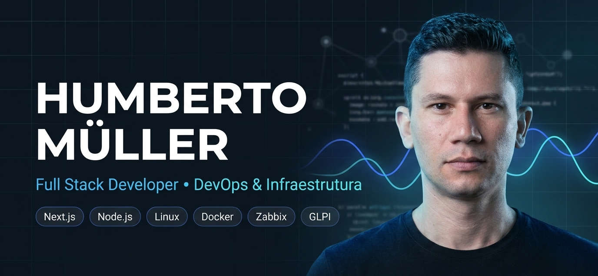

<!-- Header Banner -->
<div align="center">
  
</div>

<!-- Typing Animation -->
<div align="center">
  <a href="https://github.com/hmiiller">
    
  </a>
</div>

<br/>

<!-- Social Badges & Views -->
<div align="center">
  <a href="https://www.linkedin.com/in/humbertomiiller/" target="_blank">
    
  </a>
  <a href="https://github.com/hmiiller" target="_blank">
    
  </a>
  <a href="https://instagram.com/humberto.pxto" target="_blank">
    
  </a>
  
</div>

---

## ⚡ Sobre Mim

```ts
const humberto = {
  role: "Desenvolvedor Web Full Stack & Analista de Infraestrutura",
  organization: "SEDS-GO — Secretaria de Estado de Desenvolvimento Social",
  education: "Tecnólogo em Segurança da Informação",
  experience: "7+ anos em Tecnologia",
  focus: [
    "Aplicações Web de Alta Fidelidade (Next.js / React / Node.js)",
    "Automação ITSM & Integrações REST com GLPI",
    "Observabilidade & Telemetria (Zabbix 7.0, PaperCut, SNMP)",
    "Resiliência Linux, Docker, Nginx, PM2 & Windows Server (AD/GPO)"
  ],
  architecturePhilosophy: "Sistema Mestre: unificação de logs, métricas, SLAs e serviços em tempo real"
};
```

---

## 🛠️ Stack Tecnológica

<div align="center">

| Camada | Tecnologias |
| :--- | :--- |
| **Frontend & UI** |      |
| **Backend & Real-Time** |      |
| **Dados & Cache** |     |
| **Infra, DevOps & ITSM** |      |

</div>

---

## 🚀 Sistemas Concluídos em Produção

> **🔒 Aviso Institucional & Confidencialidade:**  
> Os sistemas abaixo foram arquitetados e desenvolvidos para atender demandas e especificações internas da **Secretaria de Estado de Desenvolvimento Social de Goiás (SEDS-GO)**.  
> Por razões de **segurança da informação, proteção de infraestrutura e governança institucional**, o código-fonte dessas aplicações é mantido exclusivamente em **ambiente/repositório privado**, não sendo publicado em repositórios públicos. As informações aqui apresentadas têm caráter estritamente demonstrativo de arquitetura e stack tecnológica, sem exposição de dados, credenciais ou endpoints internos.

| Status | Sistema | Propósito & Impacto | Stack | Acesso |
| :---: | :--- | :--- | :--- | :---: |
|  | **ADMGOV** | Painel de telemetria e resiliência de servidores com integração **Zabbix 7.0** (JSON-RPC Bearer), alertas sonoros/visuais, terminal de logs PM2 filtrado e rotina automática de backups SQLite (retenção 7 dias). | `Next.js 15` `Prisma` `Zabbix 7.0` `PM2` | 🔒 Privado (SEDS-GO) |
|  | **SGC SEDS Mobile** | Aplicativo Web Progressivo (**PWA**) mobile-first integrado à API REST do GLPI: abertura guiada de chamados, upload em chunks via Redis, biometria/PIN, triagem por IA, carrossel de comunicados e painel de SLA. | `Next.js 15` `React 19` `Redis 7` `Docker` | 🔒 Privado (SEDS-GO) |
|  | **Monitor de SLAs GLPI** | Dashboard estilo **NOC** em tempo real para acompanhamento de SLAs de atendimento (TTO) e solução (TTR), com proxy seguro (Helmet/CSP), contadores ao vivo e matriz RBAC por perfil/entidade. | `Node.js` `Express` `Vanilla JS` `GLPI API` | 🔒 Privado (SEDS-GO) |
|  | **Auditor SLA Painel** | Plataforma full-stack em contêiner **Docker** para fiscalização de contratos de TI, auditoria de SLAs e cálculo de glosas no HUB TI com autenticação GLPI. | `React (Vite)` `Express` `PostgreSQL` `Docker` | 🔒 Privado (SEDS-GO) |
|  | **SEDS Hub TI - Reservas** | Gestão e agendamento de equipamentos tecnológicos com validação de choque de horário, controle de devoluções e autenticação centralizada via LDAP/GLPI. | `React 19` `TypeScript` `Prisma` `PostgreSQL` | 🔒 Privado (SEDS-GO) |
|  | **Monitoramento de Impressão** | Painel de telemetria em tempo real para servidores de impressão e níveis de toner via **PaperCut** e protocolo **SNMP**, com abertura automática de chamados no SGC/GLPI. | `React 19` `Tailwind v4` `Node.js` `SNMP` | 🔒 Privado (SEDS-GO) |
|  | **Atendimento WhatsApp Bot** | Plataforma multiusuário via WhatsApp (**Baileys**) com chatbot de IA, fila de atendimento em tempo real via WebSocket, notificações push, RBAC e histórico completo. | `Next.js 14` `Socket.io` `Baileys` `Drizzle` | 🔒 Privado (SEDS-GO) |

<details>
<summary>🔍 <b>Ver detalhes de arquitetura e segurança aplicados nos sistemas</b></summary>

- **BFF & Proxy Seguro:** Tokens corporativos (`App-Token`, `Session-Token`, `ZABBIX_API_TOKEN`) isolados estritamente no servidor via cookies `httpOnly` e cabeçalhos `Authorization: Bearer`.
- **Controle de Acesso (RBAC):** Validação ID-First integrada aos perfis e entidades do GLPI, garantindo isolamento de filas e painéis gerenciais.
- **Alta Disponibilidade:** Deploy containerizado com Docker Compose + Healthchecks ou daemonizado com PM2 + Logrotate e proxy reverso Nginx.
- **Resiliência Offline & Performance:** Upload fragmentado em chunks com reconstrução em Redis, modo offline outbox e tipagem estrita TypeScript.

</details>

---

## 📊 Métricas no GitHub

<div align="center">
  
  
</div>

<div align="center">
  
</div>

<div align="center">
  
</div>

---

<!-- Footer Wave Banner -->
<div align="center">
  
</div>
